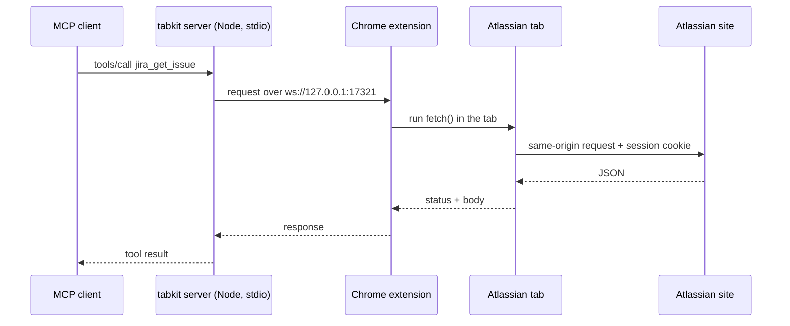

<div align="center">
  <h1>tabkit</h1>
  <p><strong>Jira and Confluence for your AI agent, through the Chrome tab you are already logged in to.</strong><br/>A read-only MCP server and a small Chrome extension. No API token: each request runs in an Atlassian tab, so Chrome adds your session the way it does for Jira's own pages.</p>

  <p>
    <a href="LICENSE"></a>
    
    
    
    
  </p>

  <p>
    <a href="https://heybrahim.com/projects/tabkit.html"><strong>Project page</strong></a> ·
    <a href="https://github.com/brbousnguar/pilotkit">pilotkit, the API-token sibling</a>
  </p>

  <p>
    <a href="#setup">Setup</a> ·
    <a href="#tools">Tools</a> ·
    <a href="#how-it-works">How it works</a> ·
    <a href="#security">Security</a> ·
    <a href="#what-is-tested">What is tested</a>
  </p>
</div>

---

An Atlassian API token is the usual way to give an agent access to Jira. Not everyone can create one, and some companies would rather not have one on every laptop. Your browser is already logged in, though.

tabkit lets Claude Code, GitHub Copilot or Codex read Jira and Confluence with that session. The MCP server runs on your machine, the extension runs each request inside an Atlassian tab, and your session cookie never leaves Chrome.

It is the sibling of [pilotkit](https://github.com/brbousnguar/pilotkit): pilotkit uses an API token and works without a browser, tabkit uses your Chrome tab and needs nothing else. Pick the one your company allows.

## Setup

You need Node.js 20+, Google Chrome 116+, and an Atlassian Cloud site (`https://<name>.atlassian.net`) you are logged in to in Chrome.

1. Get the code and install the server's dependencies:

   ```bash
   git clone https://github.com/brbousnguar/tabkit.git
   cd tabkit
   npm install
   ```

2. Load the extension: open `chrome://extensions`, turn on **Developer mode**, click **Load unpacked**, and pick the `extension/` folder.

3. Pair the server and the extension. This prints a token, and creates `~/.tabkit/pairing-token` on the first run:

   ```bash
   npm run -s pairing-token | pbcopy     # macOS
   npm run -s pairing-token | clip       # Windows
   ```

   Click the tabkit icon in Chrome, set **Atlassian site** to your site, paste the token in **Pairing token**, and click **Save**.

4. Add the server to your MCP client, then start a new session. Replace `/path/to/tabkit` with the folder from step 1.

   **Claude Code**

   ```bash
   claude mcp add tabkit -- node /path/to/tabkit/src/index.js
   ```

   **GitHub Copilot CLI**

   ```bash
   copilot mcp add tabkit -- node /path/to/tabkit/src/index.js
   ```

   **VS Code (Copilot agent mode)**: in `.vscode/mcp.json`, or your user `mcp.json` (**MCP: Open User Configuration**):

   ```json
   {
     "servers": {
       "tabkit": {
         "type": "stdio",
         "command": "node",
         "args": ["/path/to/tabkit/src/index.js"]
       }
     }
   }
   ```

   **Codex**: in `~/.codex/config.toml`:

   ```toml
   [mcp_servers.tabkit]
   command = "node"
   args = ["/path/to/tabkit/src/index.js"]
   ```

5. Ask your agent "who am I in Jira?". It calls `atlassian_whoami`, and the popup shows **Connected to 1 MCP server(s)**.

A server that just started is found within 30 seconds, the shortest period of a Chrome alarm. A tool called before that waits for the extension.

| Variable | Default | Purpose |
|---|---|---|
| `TABKIT_PORTS` | `17321-17330` | Ports to try; the extension's **Ports** field must match |
| `TABKIT_PAIRING_FILE` | `~/.tabkit/pairing-token` | Where the pairing token is kept |
| `TABKIT_PAIRING_TOKEN` | none | Use this token instead of the file (tests) |
| `TABKIT_CONNECT_TIMEOUT_MS` | `35000` | How long a tool waits for the extension to connect |

## Tools

Four read tools. They run with your own Atlassian permissions, because it is your browser session.

| Tool | What it returns |
|---|---|
| `atlassian_whoami` | The site, the bridge port and the account logged in there. Call it first when another tool fails |
| `jira_get_issue` | One issue by key. `fields` limits the fields, `expand` adds `changelog` or `renderedFields` |
| `jira_search_issues` | Issues for a JQL query, one page per call (`maxResults` 1-100, default 10). While `isLast` is `false`, call again with the returned `nextPageToken`. `defaultFields: false` returns only the fields you list |
| `confluence_get_page` | One Confluence page by id, with its storage-format body when `includeStorage` is `true` |

```json
{ "jql": "assignee = currentUser() AND statusCategory != Done", "fields": ["customfield_10016"] }
```

## How it works



The extension does not read your cookies. It uses `chrome.scripting` to run a `fetch()` inside a tab of your Atlassian site. That request is same-origin, so Chrome attaches the session exactly as it does when Jira's own page loads an issue. The extension gets back the status and the JSON body, nothing else.

- The server listens on the first free port of `17321-17330`, so several sessions can run at once. The extension connects to every port of that range that answers.
- The request runs in any open tab of your site. Without one, the extension opens `/rest/api/3/serverInfo` in a background tab and keeps it.
- The service worker pings each server every 20 seconds so Chrome keeps it alive while a server is connected.

## Security

- **Pairing.** The server and the extension share a token. Each side proves it holds it with an HMAC-SHA256 over a fresh random value, so the token itself never crosses the socket.
- **Local only.** The server binds `127.0.0.1` and refuses any origin that is not `chrome-extension://`, so a web page cannot connect to it.
- **Read-only, enforced in the extension.** It sends `GET` to `/rest/api/3/`, `/rest/agile/1.0/`, `/wiki/rest/api/` and `/wiki/api/v2/`, plus `POST` to the two Jira search endpoints that only exist as `POST`. Anything else is refused before it reaches the tab.
- **One site.** Only `https://*.atlassian.net`, and only the one set in the popup.

A process running as you on the same machine can read the pairing file, so it is trusted the same way your shell is.

## What is tested

- `npm test`: 9 tests. The server runs against a fake extension that pairs over the real protocol and answers like Atlassian. No browser, no network.
- `npm run test:chrome`: the real extension, unpacked, in headless Chrome for Testing 153, against a Jira Cloud site that allows anonymous reads (`hibernate.atlassian.net`). It checks the pairing, the background tab, `jira_search_issues`, `jira_get_issue` and the `401` hint of `atlassian_whoami`. It passed on macOS on 2026-10-14. Run `npx playwright-core install chromium` first, or set `TABKIT_CHROME` to a Chrome binary.

Not tested yet: a logged-in session on a private site, `confluence_get_page` on a real page, Windows and Linux, and the Copilot clients. If you try one of these, tell me what breaks in an issue.

## Limits

- Chrome must be open, with the extension loaded and paired. When the Atlassian session expires, log in again in Chrome; until then the tools answer `401` with that hint.
- Jobs that run without your browser (a night job, an agent on another machine) need an API token: use [pilotkit](https://github.com/brbousnguar/pilotkit).
- Chrome may show one extra tab on your site. It is the one the extension uses, and you can close it at any time.

---

## Tech stack

| Layer | Technology |
|---|---|
| Server | Node.js 20+, native ES modules, no build step |
| Protocol | Model Context Protocol SDK, `stdio` transport |
| Bridge | `ws` WebSocket server on `127.0.0.1` |
| Extension | Chrome Manifest V3: module service worker, `chrome.scripting`, `chrome.alarms` |
| Pairing | HMAC-SHA256 with WebCrypto, one module shared by the server and the extension |

## Repository layout

```text
.
├── src/
│   ├── index.js          # MCP server: the four tools, calls through the bridge, error hints
│   ├── bridge.js         # WebSocket server: port choice, pairing, request/response relay
│   └── pairing.js        # The pairing token file
├── extension/
│   ├── manifest.json
│   ├── background.js     # Service worker: connects to the servers, runs requests in a tab
│   ├── protocol.js       # Shared with the server: port range, nonces, HMAC proofs
│   ├── settings.js       # Site, token and ports from chrome.storage
│   ├── popup.html
│   └── popup.js          # Site, token and ports form, connection status
├── scripts/
│   └── pairing-token.js  # npm run pairing-token
├── test/
│   ├── fake-extension.js # Plays the extension in tests
│   ├── bridge.test.js    # Pairing, refusals, port choice, errors
│   ├── server.test.js    # The MCP server end to end over stdio
│   └── chrome.e2e.js     # npm run test:chrome, in a real browser
└── package.json
```

## License

[Apache-2.0](LICENSE)
